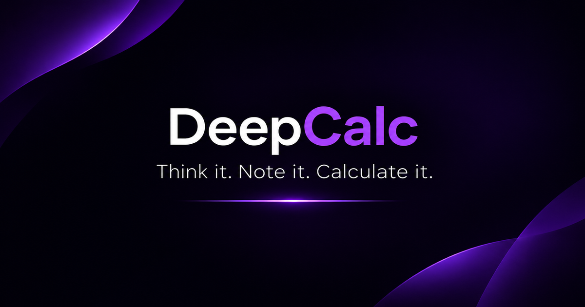

<p align="center">
  <a href="https://prasannaone.github.io/DeepCalc/">
    
  </a>
</p>

<h1 align="center"><a href="https://prasannaone.github.io/DeepCalc/">DeepCalc ↗</a></h1>
<p align="center"><strong>Write it. Work it out. See it unfold.</strong></p>
<p align="center">
  <a href="https://github.com/PrasannaOne/DeepCalc">Source</a> ·
  <a href="LICENSE">MIT License</a> ·
  <a href="https://github.com/tigrino/soulcalc">Based on SoulCalc</a>
</p>

<p align="center">
  <a href="https://prasannaone.github.io/DeepCalc/"></a>
</p>

DeepCalc is a **notepad calculator**. Work through connected calculations, reuse variables and previous results, add separate notes, and see every line update as you edit.

It is a browser-based adaptation of [SoulCalc](https://github.com/tigrino/soulcalc), with a responsive interface and installable Progressive Web App.

## What it does

- **Calculation sheets:** write multi-line calculations with live results.
- **Variables:** define values such as `$price = 49.99` and reuse them later.
- **Line references:** use `$1`, `$2`, and so on to refer to earlier results.
- **Notes:** attach independent notes to calculation lines. Notes never affect evaluation.
- **Flexible input:** use the built-in keypad or switch to your device keyboard.
- **Quick actions:** insert paired parentheses, paste at the cursor, copy expressions or results.
- **History:** save named snapshots, then reopen, rename or delete them.
- **Themes:** System, Light, Dark and true-black AMOLED, with five accent palettes.
- **Installable:** use DeepCalc in a browser or install it as a PWA.

## Quick examples

| Input | Result |
|---|---:|
| `12 + 8` | `20` |
| `(12 + 8) × 2` | `40` |
| `2 ^ 8` | `256` |
| `sqrt(81)` | `9` |
| `100 + 10%` | `110` |

### Variables

```text
$price = 49.99
$quantity = 3
$price × $quantity
```

### Previous results

```text
100 + 50
$1 × 2
$1 + $2
```

### Comments

Start a comment line with `#`.

```text
# Monthly budget
$income = 5000
$rent = 1500
$income - $rent
```

Percentages follow calculator-style context rules. For example, `100 + 10%` gives `110`, while `10%` by itself gives `0.1`.

## Your sheets and your data

- The active sheet is saved automatically in the browser.
- **Save Sheet** creates a separate snapshot in History.
- Saved snapshots include calculation lines and notes.
- History keeps up to 100 saved sheets.
- Data is stored locally on the device. There is no account or cloud sync.
- Clearing browser/site data can erase saved work. Keep a separate copy of anything important.

## Install and offline use

1. Open [DeepCalc](https://prasannaone.github.io/DeepCalc/) in a supported browser.
2. Choose **Install app** or **Add to Home Screen**, if offered.
3. Launch it from your home screen or app launcher.

The first visit needs an internet connection. The service worker caches the app shell so it can reopen offline after the required files have been cached. Offline availability depends on browser storage policies.

## Project files

All application files live in the repository root.

| File | Responsibility |
|---|---|
| `index.html` | App structure, metadata, dialogs and entry point |
| `styles.css` | Layout, responsive behaviour, themes and visual states |
| `app.js` | App state, storage, calculation engine, editing, keypad, notes, sharing and History |
| `manifest.webmanifest` | PWA name, launch settings and icon declarations |
| `service-worker.js` | App-shell caching, offline fallback and update lifecycle |
| `icon-192.png`, `icon-512.png` | PWA icons |
| `icon-maskable-512.png` | Maskable PWA icon |
| `apple-touch-icon.png`, `favicon-32.png` | Browser and home-screen icons |
| `og-image.png` | Link preview artwork |
| `README.md` | Project documentation |
| `LICENSE` | Original MIT licence and copyright notice |

## Run locally

From the repository directory, start a local server:

```bash
python -m http.server 8000
```

Open [http://localhost:8000](http://localhost:8000). A local server is preferable to opening the HTML file directly. Service workers require HTTPS or localhost.

## Maintenance notes

- Keep the calculation tokenizer, parser, evaluator and sheet behaviour aligned with the original project.
- When changing cached app files, update the cache name in `service-worker.js` and keep its core-file list accurate.
- Keep every manifest icon path aligned with the actual root filenames, including letter case.
- Test expressions, percentages, variables, line references, editing, notes, History, themes, narrow screens, offline startup and updates before publishing.
- Browser storage is local. Do not describe it as cloud backup or cross-device sync.

## Credits

DeepCalc is a web adaptation and ongoing project by [PrasannaOne](https://github.com/PrasannaOne).

It is based on [SoulCalc](https://github.com/tigrino/soulcalc), originally created by **Albert “Tigr” Zenkoff**. The original MIT licence and copyright notice are retained in this repository.
